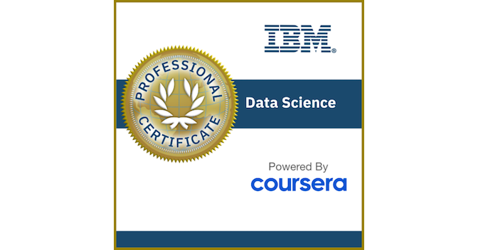

# IBM Data Science Professional Certificate

Completed by **Elven Nunes Junior** on **October 10, 2026**.

The 12-course IBM program on Coursera covers Python, SQL, data preparation, visualization, machine learning and generative AI. This repository contains my SpaceX Falcon 9 capstone project, completion certificate and digital badge.

## Certificate and digital badge

- [Professional Certificate PDF](certificates/IBM_Data_Science_Professional_Certificate_A0RHXCNNKOOF.pdf)
- [Verify credential A0RHXCNNKOOF](https://www.coursera.org/verify/professional-cert/A0RHXCNNKOOF)
- [Verify IBM Data Science Professional Certificate (V3) on Credly](https://www.credly.com/badges/199c233f-e1c2-4b45-a649-5ebaaf39ff46/public_url)
- [IBM Data Science program](https://www.coursera.org/professional-certificates/ibm-data-science)

The PDF retains its original content. Its descriptive filename preserves the Coursera verification ID. The Credly badge was issued by Coursera to Elven Jr.; the image below is the original image supplied by its public badge page. Click it to view the credential.

[](https://www.credly.com/badges/199c233f-e1c2-4b45-a649-5ebaaf39ff46/public_url)

<details>
<summary>12 completed courses</summary>

1. What is Data Science?
2. Tools for Data Science
3. Data Science Methodology
4. Python for Data Science, AI & Development
5. Python Project for Data Science
6. Databases and SQL for Data Science with Python
7. Data Analysis with Python
8. Data Visualization with Python
9. Machine Learning with Python
10. Applied Data Science Capstone
11. Generative AI: Elevate Your Data Science Career
12. Data Scientist Career Guide and Interview Preparation

</details>

## SpaceX capstone

The project explores historical Falcon 9 launches and compares classifiers for first-stage landing outcomes. The workflow includes collection exercises, data wrangling, SQL and visual exploration, Folium maps, a Plotly Dash dashboard and predictive analysis.

**Final presentation assessment: 15/15 (100%).** This is the assignment grade. Model accuracy is reported separately below.

- [Final report, PDF](applied-data-science-capstone/presentation/Data_Science_Capstone_Project_Report.pdf)
- [Editable presentation, PowerPoint](applied-data-science-capstone/presentation/Data_Science_Capstone_Project_Report.pptx)
- [Grading feedback, 100%](applied-data-science-capstone/presentation/1791646837589_Data_Science_Capstone_Project_Report_feedback.pdf)

The presentation has 47 slides with methods, results, maps, dashboard views, a confusion matrix and conclusions. The original feedback filename is retained for traceability.

## Repository contents

| Location | Contents |
| --- | --- |
| [Notebooks](applied-data-science-capstone/notebooks/README.md) | Index of seven IBM laboratory notebooks, inputs and execution notes. |
| [Data](applied-data-science-capstone/data/) | Prepared EDA and modeling datasets, dashboard records and the scraping export. |
| [Dashboard](applied-data-science-capstone/dashboard/spacex-dash-app.py) | Site selection, success pie charts and payload filtering. |
| [Figures](applied-data-science-capstone/figures/) | Dashboard screenshots for all sites and individual launch sites. |
| [Presentation](applied-data-science-capstone/presentation/) | Final report, editable slides and assessment feedback. |
| [Certificates](certificates/) | Coursera certificate PDF and original Credly badge image. |

## Classification results

| Model | 10-fold CV accuracy | Test accuracy |
| --- | ---: | ---: |
| Logistic Regression | 84.64% | 83.33% |
| SVM | 84.82% | 83.33% |
| Decision Tree | 87.68% | 83.33% |
| KNN | 84.82% | 83.33% |

Decision Tree has the highest stored cross-validation score. All four models produce identical predictions on the 18-launch test set, with 15 correct predictions. The confusion matrix contains 12 true positives, 3 true negatives, 3 false positives and no false negatives. Success precision is 80% and recall is 100% on this sample.

## Additional findings

In the 56-launch dashboard dataset, KSC LC-39A has a 76.9% success rate (10/13) and contributes 41.7% of successful launches across all sites (10/24). These percentages use different denominators.

Exact NASA CRS labels total 45,596 kg of payload in the SQL dataset. Including shared NASA-tagged missions changes the total to 107,010 kg, showing how query scope affects interpretation.

## Run the dashboard

From the repository root:

```bash
python -m pip install pandas plotly dash
cd applied-data-science-capstone/data
python ../dashboard/spacex-dash-app.py
```

Open [the local dashboard](http://127.0.0.1:8050).

## Data scope and reproducibility

EDA and modeling use 90 records, SQL uses 101, and the dashboard and report maps use 56. Compare totals within the relevant dataset.

Original laboratory notebooks retain their saved executions, including API errors, an empty scraping export and unfinished Folium exercise cells. The report uses prepared IBM datasets, excludes the empty export and includes maps reproduced separately from the IBM geospatial dataset. See the [notebook execution notes](applied-data-science-capstone/notebooks/README.md#execution-notes).

The saved modeling workflow fits the scaler before the train/test split. Further evaluation should fit preprocessing inside cross-validation and test future launches chronologically. The target follows the course definition of landing success, including some ocean outcomes.
